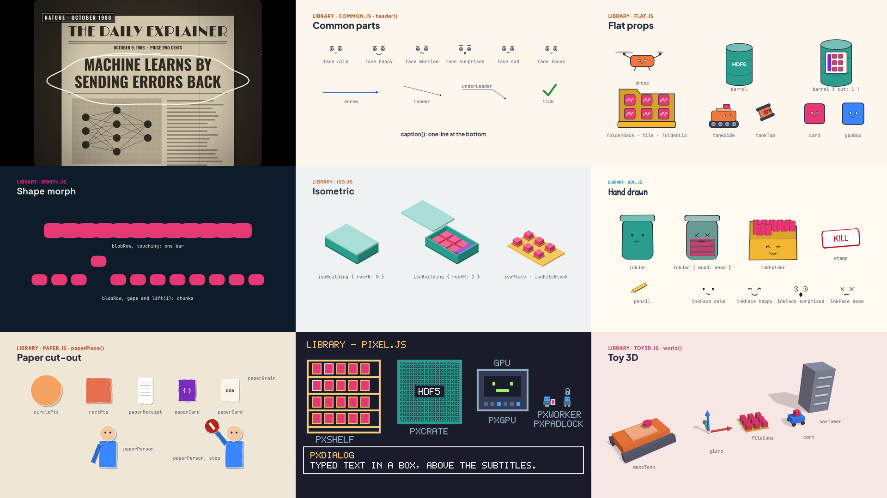
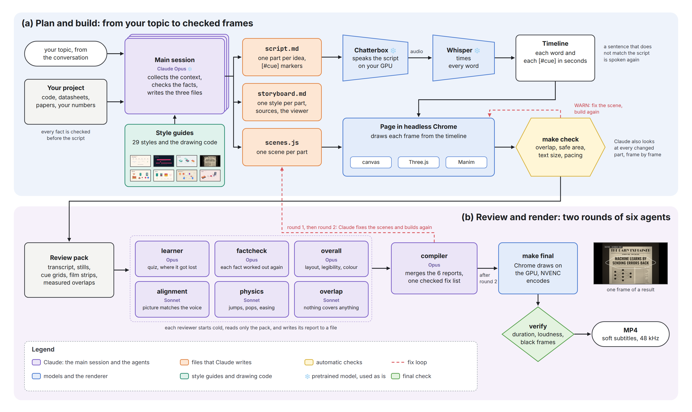
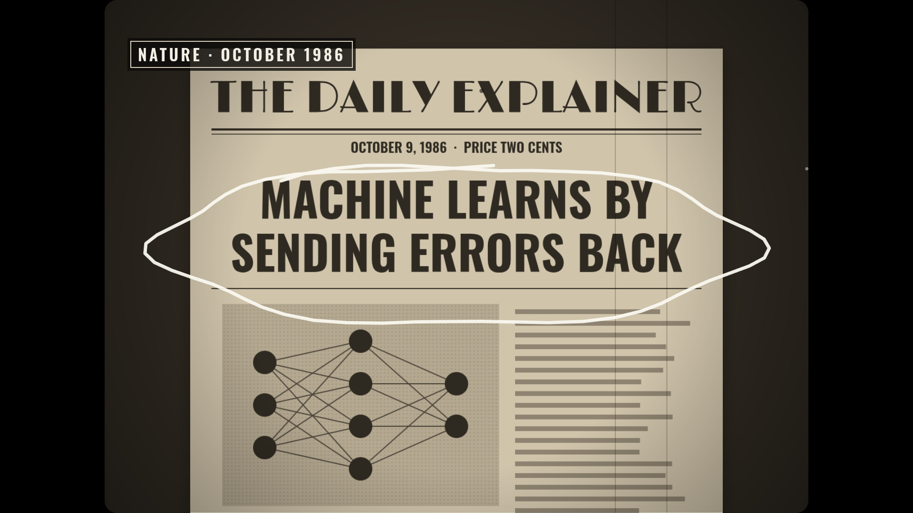
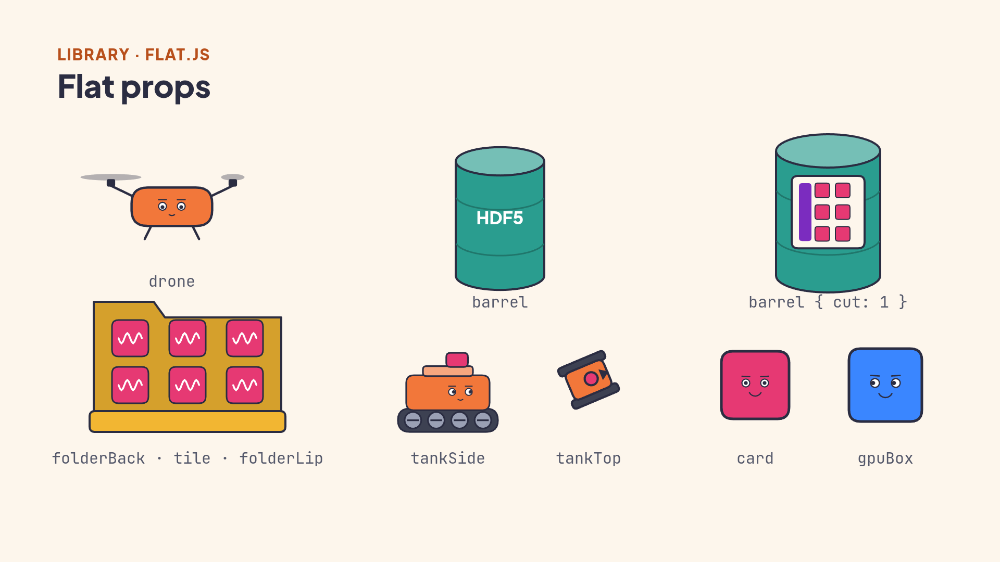
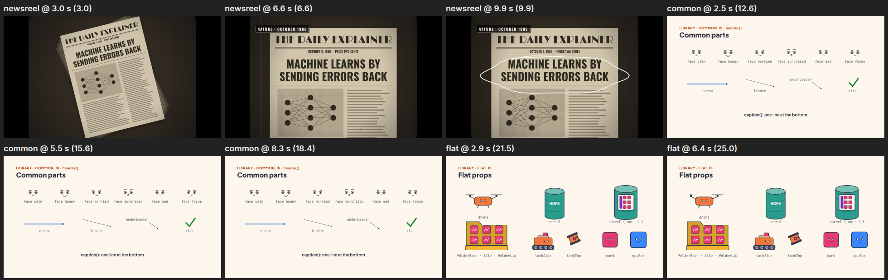

<div align="center">

# Kaleidoscope

A Claude Code skill that makes a narrated teaching video about a topic.<br>
Every part of the video has its own animation style, and six reviewer agents check the video before it renders.



<sub>Code draws every frame in all 29 styles, without a video model. The voice model runs on your own GPU.</sub>

<a href="https://jjietay.github.io/kaleidoscope/"><b>Open the gallery page</b></a>

</div>

## How a video is made



## What makes it different

| A new style for each part | Characters that act | Checked before render |
|:---:|:---:|:---:|
|  |  |  |
| Each idea gets the style that explains it best, for example a newsreel for the history of an idea and Manim for a formula. | Objects can have faces and move like real objects. The tank rolls in, and a block drops and settles. | Claude reads contact sheets like this one. Then a fact checker, a first-time learner and four picture checkers review the video. |

## Try it

In Claude Code, in the conversation where the topic came up:

> Make a video explaining how the EKF fuses wheel odometry and the IMU.

> Make a video on I2C for the BNO085, and tell its history as a 1920s newsreel.

## The styles

| Kind | Styles |
|---|---|
| Maths and diagrams | `math-manim` `signal-graph` `pixel-grid` `single-line` `shape-morph` `whiteboard` `blueprint` |
| Characters and stories | `flat-vector` `line-boil` `paper-cutout` `pixel-art` `midcentury-toon` `watercolour` `risograph` |
| 3D and space | `isometric` `iso-infographic` `toy-3d` `teardown` `desktop-flythrough` `transit-map` |
| Data and evidence | `data-story` `data-physical` `briefing-board` `telestrator` `swiss-type` `dark-keynote` `hud-terminal` `film-crt` `newsreel` |

[`styles/README.md`](styles/README.md) says which style fits which kind of idea.

## Install

```bash
npx kaleidoscope-video
```

The setup checks your machine, asks 5 questions (folder, token budget, voice, Manim, reviewer agents), shows the plan, and installs only what you choose. It works without a GPU: then the Kokoro voice speaks and the CPU draws the frames.

Later, in Claude Code, `/setup-kaleidoscope` changes the token budget or the voice:

| Budget | Review |
|---|---|
| `high` | 2 rounds, 6 reviewers, Opus for the hard checks |
| `medium` | 1 round, 6 reviewers on Sonnet, the fact check on Opus |
| `low` | 1 round, 2 reviewers on Sonnet |

[`INSTALL.md`](INSTALL.md) has the manual setup.

## The reviewer agents

| Agent | What it checks |
|---|---|
| `video-factcheck` | every fact, number and formula, worked out again |
| `video-learner` | a first-time viewer answers a quiz and says where it got lost |
| `video-alignment` | the picture shows what the voice says, at that moment |
| `video-overlap` | no text or drawing covers another |
| `video-physics` | motion: jumps, pops, easing, weight |
| `video-overall` | layout, legibility, colour meaning, pacing |
| `video-compiler` | joins the six reports into one short fix list |

## Repo layout

| Path | What it holds |
|---|---|
| `SKILL.md` | the workflow the agent follows, step by step |
| `bin/`, `package.json` | the setup that `npx kaleidoscope-video` runs |
| `setup/` | the `/setup-kaleidoscope` skill: token budget, voice and GPU |
| `SOUND.md` | the background music: rules, approved tracks and their recipes |
| `agents/` | the reviewer agents; the install links them into `~/.claude/agents` |
| `engine/` | the command line `make.mjs`, the page runtime, fonts, the voice in `tts/`, the music in `music.mjs`, Manim in `manim/`, and the project template |
| `reference/` | the engine API and the script rules |
| `styles/` | one guide per style, the shared drawing code in `styles/library/`, and the credits |
| `gallery/` | one sample project, with its pictures in `png/` and 30 s previews of the music tracks in `music/` |

## Credits

Kaleidoscope is under the MIT licence: see [`LICENSE`](LICENSE).
We adapted 11 styles from [Lemo-Opuscar](https://github.com/lemomo-ai/lemo-opuscar) by LemoLab and took details from it for 3 more.
Its MIT licence is in [`styles/LICENSE-opuscar`](styles/LICENSE-opuscar).
[explainroo](https://github.com/vincentsch/explainroo) times the words, [Chatterbox](https://github.com/resemble-ai/chatterbox) speaks the narration,
and [Manim Community](https://www.manim.community/) draws the maths scenes. The fonts use the SIL Open Font License.
